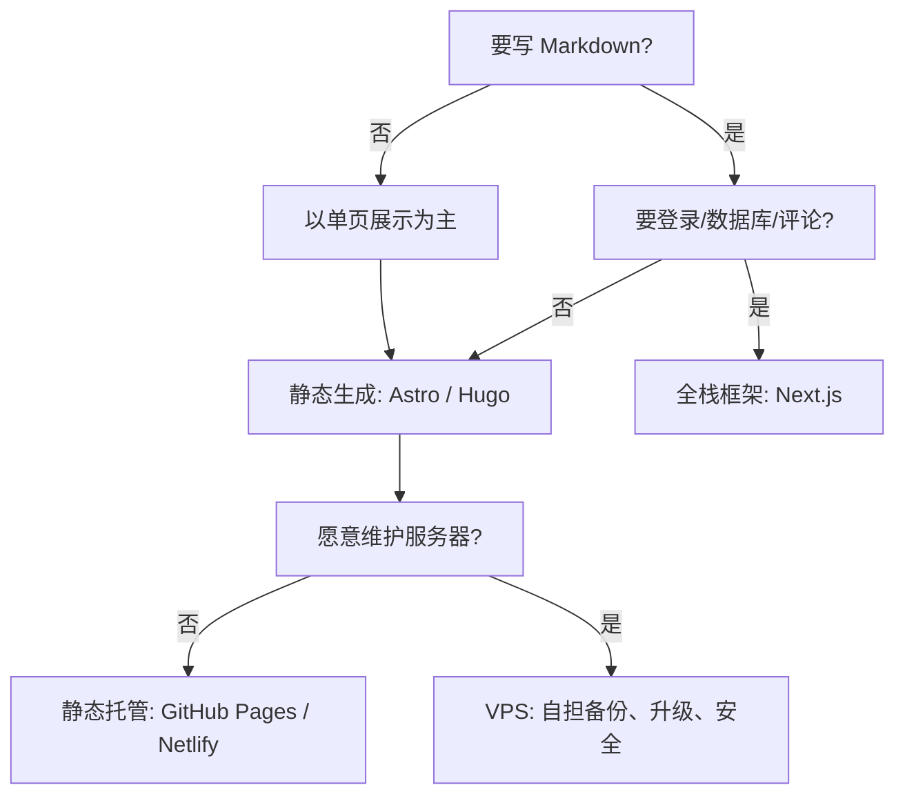

结论先行：只引一手来源（官方文档、官方 CLI 文档、官方规范站点）；标【经验判断】的条目属于工程经验，没有文档出处。

## 0. 需求与定位

- 目标：把"我想做个网站"收敛成可验收的范围。
- 动作：定站点类型（作品集/博客/简历/技术文档）→ 列页面清单（首页、列表、详情、关于、404）→ 定义内容模型（标题、日期、描述、标签四个字段起步）。
- 产出：`docs/plan.md`，含一句话定位 + 页面表 + 字段表。
- 验收：任意一个页面都能说清"数据从哪来、由谁渲染"。
- 坑：先搭框架再想内容，返工最贵【经验判断】；Hugo 的 `draft = true` 默认不构建，忘改就是"文章消失"（[quick start](https://gohugo.io/getting-started/quick-start/)）。

## 1. 选型决策树

- 目标：用三个问题把候选框架收敛到一个。
- 动作：按树回答三问，写下选择与放弃的理由。
- 产出：一页选型记录（框架 + 理由 + 被放弃的选项）。
- 验收：能写下一句"选 X 因为 Y，不选 Z 因为 W"。
- 坑：跟着教程热度选型，不看它是否真支持 Markdown 与静态产出【经验判断】。

## 2. 初始化

- Astro：`npm create astro@latest`（[install](https://docs.astro.build/en/install-and-setup/)），要求 Node ≥ v22.23.4，奇数版如 v23 不支持。
- Hugo：`hugo new project <path>`（[CLI](https://gohugo.io/commands/hugo_new_project/)）。注意 `hugo new site` 已不在官方文档（旧链接现为 404），照抄旧教程会踩空。
- Next.js：`npx create-next-app@latest`，加 `--yes` 跳过提问；Node ≥ 20.9（[install](https://nextjs.org/docs/app/getting-started/installation)）。
- 产出：能跑的最小仓库骨架 + `.gitignore`。
- 验收：`npm run dev`（Astro 默认 http://localhost:4321/）或 `hugo server` 能起站。
- 坑：Astro 官方明确"必须本地安装"，`npm install -g astro` 不成立；Hugo 在 Windows 官方要求 PowerShell 7 或 bash，不能用 cmd。

## 3. 本地开发

- 目录：Astro 用 `src/pages`（文件即路由）、`src/layouts`、`public/`；Hugo 用 `content/`、`layouts/`、`static/`。
- 热更新：`npm run dev` 监听 `src/`，改文件即刷新，无需重启；dev toolbar 能查可访问性问题（[develop and build](https://docs.astro.build/en/develop-and-build/)）。
- 产出：本地可预览的站点 + 一张常用命令小抄。
- 验收：改一处文案，浏览器立刻更新。
- 坑：`hugo server` 报找不到主题——需先 `git submodule add` 拉主题并在 `hugo.toml` 写 `theme`（[官方步骤](https://gohugo.io/getting-started/quick-start/)）。

## 4. 内容与页面开发

- 布局：抽一个 Layout 管 head、导航、footer，页面只填正文。
- 路由：文件路径即 URL；需动态页时用方括号文件名 + `getStaticPaths()`。
- 样式：先用 CSS 变量定色板与字号阶梯，再做组件级样式；移动优先断点。
- 验收：320/768/1440 三档无横向滚动，只用键盘能走完全站。
- 坑：图片不写宽高，图片加载时页面抖动，直接伤 CLS（[web.dev](https://web.dev/articles/vitals)）。

## 5. 质量检查

- Lighthouse：DevTools 的 Lighthouse 面板，或 `npm i -g lighthouse` 后 `lighthouse <url>`（[官方](https://developer.chrome.com/docs/lighthouse/overview)）。
- HTML 校验：https://validator.w3.org/ ，支持 URI、上传、粘贴三种（[官方](https://validator.w3.org/)）。
- 可访问性：按 W3C WAI 的 Easy Checks 人工过一遍；官方原话"没有工具能单独判定是否达标，需要懂行的人来评估"（[WAI](https://www.w3.org/WAI/test-evaluate/)）。
- 断链：`https://validator.w3.org/checklink`。
- 产出：检查记录（工具、日期、问题清单、修复状态）。
- 验收：validator 0 error、断链 0、Lighthouse 四项 ≥90（此阈值自定，非官方）。
- 坑：Lighthouse 的 SEO/无障碍分只是自动项，绿分不等于合规【经验判断】。

## 6. 版本管理

- 初始化：`git init`，可加 `-b main`；默认分支目前仍是 `master`，Git 3.0 才改为 `main`（[git-init](https://git-scm.com/docs/git-init)）。
- 提交粒度：官方原话"Ideally, each commit contains an isolated, complete change"，便于单独回滚（[GitHub flow](https://docs.github.com/en/get-started/using-github/github-flow)）。
- 分支：默认分支始终保持可部署；每项改动开短分支 → PR → 合并 → 删分支（同上）。
- 验收：`git log` 每条提交能一句话说清，默认分支随时可构建。
- 坑：把 `node_modules/`、`dist/` 提交进仓库；Astro 官方 `.gitignore` 写的就是 `.astro/`、`.env`、`dist/`、`node_modules/`。

## 7. 构建与部署

- 构建：Astro `npm run build` → `dist/`，先 `npm run preview` 本地验一遍；Hugo `hugo` → `public/`（各见官方文档）。
- GitHub Pages：用户站仓库名须为 `<user>.github.io`，入口 `index.html`；Settings → Pages 选发布源分支或 Actions 工作流；推送后最长 10 分钟才生效（[官方](https://docs.github.com/en/pages/getting-started-with-github-pages/creating-a-github-pages-site)）。
- 绑域名：子域用 CNAME 指向 `USERNAME.github.io`，裸域用 A 记录 `185.199.108.153`/`.109`/`.110`/`.111`；域名总长须小于 64 字符，否则证书签发失败（[HTTPS 文档](https://docs.github.com/en/pages/getting-started-with-github-pages/securing-your-github-pages-site-with-https)）。
- 开 HTTPS：Settings → Pages 勾 Enforce HTTPS，GitHub 自动签发 Let's Encrypt 证书（同上）。
- 产出：构建产物目录 + 一个可访问的线上 URL。
- 验收：http 自动跳 https，证书有效，线上打开即站点。
- 坑：页面残留 `http://` 资源即混合内容，被判不安全（GitHub 官方）；非 Jekyll 生成器要放 `.nojekyll`，否则被当 Jekyll 构建（官方）。

## 8. 上线检查清单

- SEO：`npx astro add sitemap` 生成 `sitemap-index.xml`，须先在 `astro.config.mjs` 设 `site`（[官方](https://docs.astro.build/en/guides/integrations-guide/sitemap/)）；robots.txt 里加一行 `Sitemap:`；每页填 canonical 与 OG 标签。
- 硬限制：单 sitemap ≤50MB 且 ≤5 万条 URL、UTF-8、绝对 URL；Google 忽略 `priority`/`changefreq`（[官方](https://developers.google.com/search/docs/crawling-indexing/sitemaps/build-sitemap)）。
- 性能：LCP ≤2.5s、INP ≤200ms、CLS ≤0.1，按第 75 百分位算（[web.dev](https://web.dev/articles/vitals)）。
- 其余：自定义 404 页（须真返回 404，不能 200）、favicon、分析统计；服务器与主体在大陆需 ICP 备案，入口 https://beian.miit.gov.cn/ （此条未抓取核实）。
- 产出：逐项打勾的上线验收清单。
- 验收：Search Console 提交 sitemap 成功，404 页状态码正确。

## 9. 持续维护

- 节奏：博客双周更、作品集随项目更新；固定一天当"内容日"降低启动成本【经验判断】。
- 依赖：`npm outdated` 看滞后，升级大版本前先读官方 upgrade 指南。
- 备份：仓库本身即备份，另定期导出源码包；域名与证书到期日记进日历【经验判断】。
- 产出：维护日历（内容 / 依赖 / 备份三列）。
- 验收：每月完成一次依赖升级且构建通过。

## 10. 时间估算【估算，非官方数据】

- 最小可用版（3–4 页、无博客）：1–3 天，每天 2–3 小时。
- 完整版（内容系统 + SEO + 域名 + 部署）：1–2 周。
- 假设：会基本 HTML/CSS，首次用该框架，不自建服务器；内容量超 20 篇另计。
