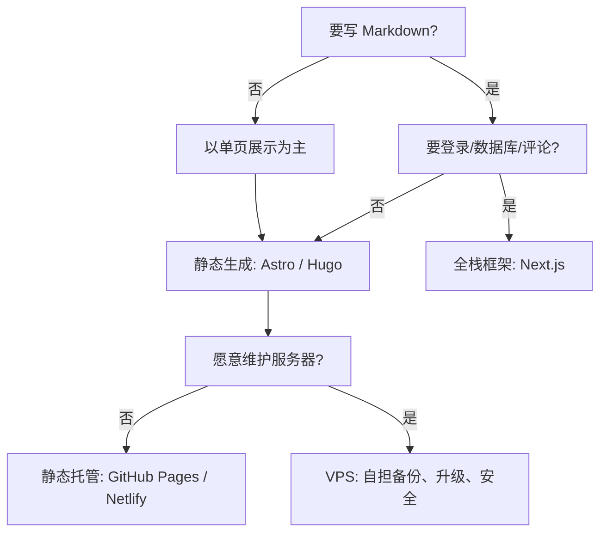

# 个人网站制作调研：方式、技术、流程

> **调研日期**：2026-11-04
> **取材口径**：只采一手来源——官方文档、W3C/WHATWG 规范、官方定价页；二手教程一律不作为依据。
> **数据时效**：价格、免费额度、版本要求均为抓取当日官方页面所示，易变项在文内单独标注。

## 结论先行

先回答三个问题，细节在后面四章。

**1）有哪些方式？** 一共 6 类，但对个人站真正值得选的是 **3 条**：

| 路线 | 代表 | 你要写代码吗 | 首版成本 | 适合谁 |
| --- | --- | --- | --- | --- |
| 静态生成器（SSG） | Astro、Hugo、Eleventy | 要（组件/Markdown） | $0（GitHub/Cloudflare 免费额度内） | 会一点前端、打算长期写 |
| 手写静态页 | 原生 HTML/CSS/JS | 要（纯手写） | $0 | 5–10 页、想完全掌控、练手 |
| 托管建站平台 | Ghost(Pro)、Super.so、Squarespace、Wix | 不要 | $16/月起（Super）、$18/月起（Ghost，年付） | 只想写、不想碰构建与部署 |
| 全栈框架 | Next.js、Nuxt、SvelteKit | 要（组件+路由+数据） | $0 起；Vercel Pro $20/月 | 站点会长成产品（登录/评论/后台） |
| 自托管 CMS | WordPress、Ghost 自建 | 要（运维 PHP/Node + 数据库） | 软件免费，主机成本未核实 | 需要插件生态、有人管服务器 |
| 文档型 SSG | VitePress、MkDocs Material | 要（Markdown） | $0 | 文档/知识库为主 |

**2）要应用哪些技术？** 不是"很多技术"，而是一条很短的链：

```
HTML 语义 + CSS + 少量 JS   →   Markdown + frontmatter   →   Git
        ↓                            ↓                        ↓
   页面结构与样式              内容与页面生成           版本管理与回滚
        ↓
Node + 构建工具（Vite/Astro/Hugo）→ 静态产物 dist/ → 静态托管 + 域名 + HTTPS
```

真正的**入门门槛只有三项**：HTML/CSS 基础、Markdown 写作、Git 提交推送。其余（Tailwind、评论、站内搜索、分析统计、结构化数据）全是按需增强，不是前置条件。

**3）流程是什么样？** 固定十个阶段，且时间分布很偏：

| 阶段 | 占比感觉 | 卡点 |
| --- | --- | --- |
| 0 需求与定位、1 选型 | 15% | 想不清楚要做什么，反复换框架 |
| 2 初始化、3 本地开发 | 10% | 环境（Node 版本、Windows 下的命令差异） |
| 4 内容与页面开发 | **45%** | 真正的工作量都在这 |
| 5 质量检查、6 版本管理 | 10% | 忘了无障碍与图片尺寸 |
| 7 构建部署、8 上线检查 | 15% | 域名解析、HTTPS、sitemap |
| 9 维护、10 时间估算 | 5% | 装完就不管，依赖腐烂 |

**一句话结论**：个人网站今天是**静态优先**的工程——内容用 Markdown，页面用一个 SSG 生成，产物丢给免费静态托管，配一个域名和自动 HTTPS。这个组合 $0 起、无服务器、可长期维护，覆盖 90% 的个人站需求。

## 怎么读这份笔记

- 只想知道选哪条路 → 看第一章的六类对比和文末"给这个仓库的建议"。
- 想知道要学什么 → 看第二章的分层（最小可用集 / 常见增强 / 进阶）。
- 想直接动手 → 看第三章的阶段 0–10，每阶段都有动作、产出与验收标准。
- 关心钱和域名 → 看第四章的成本表（含"未核实"标注）。

标注约定：**【判断】** 是我的取舍意见，不是官方声明；**"未核实"** 表示该项未能从一手来源取得。

---

## 一、有哪些制作方式

### 个人网站/博客的六类建站路线

**口径**：数据抓取于 2026-11-04；价格取自官方定价页，Squarespace/Wix 会按访问 IP 本地化币种（此处为 HK$ 与含 GST 的 US$），促销单独标注，取不到写"未核实"。【判断】为我的取舍，非官方声明。

#### 1. 手写静态站（原生 HTML/CSS/JS）

适合页面少、想掌控标记的人：编辑器即可开工，无构建链，任何静态托管可放；开发体验就是改完刷新，没有热更新与内容校验。代价是无模板与内容工作流，改版靠手工，页面一多就退化。定制 100%，成本≈0——GitHub Free 已含 Pages，限制站点 ≤1 GB、带宽软限 100 GB/月（[Pages 限制](https://docs.github.com/en/pages/getting-started-with-github-pages/github-pages-limits)、[GitHub 定价](https://github.com/pricing)）；入门看 MDN [第一个网站](https://developer.mozilla.org/en-US/docs/Learn_web_development/Getting_started/Your_first_website)。【判断】适合学习与单页作品集，不适合持续写作。

#### 2. 静态站点生成器（SSG）

| 产品 | 官方定位 | 栈/门槛 | 成本 |
|---|---|---|---|
| [Astro](https://docs.astro.build/en/concepts/why-astro/) | content-driven 站点，islands 架构削减 JS | JS/TS，组件近 JSX，中 | 免费开源 |
| [Hugo](https://gohugo.io/about/features/) | 单二进制、秒级构建，内置图片/Sass/多语言 | Go 模板，中 | 免费开源 |
| [Eleventy](https://www.11ty.dev/docs/) | README 自述"更简单的 SSG，Jekyll 替代" | JS，模板最自由，中低 | 免费开源 |
| [Docusaurus](https://docusaurus.io/docs) | 文档站专用：React SPA + 版本化/i18n/搜索 | React，中 | 免费开源 |

适合把写作留在 Markdown、又不想租服务器的人。差异在约定多少：Astro 定好岛与水合，写博客最省心；Hugo 胜在速度与资产管线，但要学模板函数；Eleventy 约定最少、要自己拼装；Docusaurus 是文档站最优解，做博客需绕开文档心智。另有 [Jekyll](https://jekyllrb.com/docs/)（Ruby，最老牌、环境偏重）。【判断】共性：纯静态、托管便宜、SEO 好；共性问题：评论、搜索、后台都得自己接。

#### 3. React/Vue 全栈框架

| 框架 | 渲染能力 | 备注 |
|---|---|---|
| [Next.js](https://nextjs.org/docs/app/building-your-application/rendering) | SSG / SSR / ISR 同处 App Router | ISR：先发静态壳，访问后增量补全 |
| [Nuxt](https://nuxt.com/docs/guide/concepts/rendering) | 默认 universal（SSR），一行配置切渲染模式 | Vue 生态 |
| [SvelteKit](https://svelte.dev/docs/kit/adapter-static) | adapter-static 全站预渲染即 SSG | 也可只预渲染部分路由 |
| [Remix](https://remix.run/) | 自称 fully-stacked web framework | [文档站](https://remix.run/docs)提示 React Router v7 已发布，选型先确认版本【判断】 |

SSG 构建时生成 HTML，SSR 每请求现渲染，ISR 先静态后按需再生。适合确定要登录、评论、后台的站点，门槛最高，要懂组件、路由与数据加载；开发体验最好；定制受框架约定约束。优点是不用中途换栈，缺点是依赖多、升级勤。【判断】纯博客用它属于过度工程。

#### 4. 传统 CMS 自托管

适合要插件扩展（电商、会员、论坛）且有人管服务器的人。[WordPress](https://wordpress.org/about/) 开源，插件与主题生态最大，自托管需 PHP + MySQL 与运维，软件免费、主机成本未核实。[Ghost](https://ghost.org/docs/install/) 开源 Node，写作与邮件订阅体验最顺，[Ghost(Pro)](https://ghost.org/pricing/) 为 Starter $18、Publisher $29、Business $199（USD/月，年付折算）。优点：可视化后台、非技术作者可写、插件可扩；缺点：升级备份与安全自负，动态渲染对纯内容站是额外负担。

#### 5. 托管平台 / 无代码

| 产品 | 官方价（抓取日） | 备注 |
|---|---|---|
| [Squarespace](https://www.squarespace.com/pricing) | Basic HK$179/月；年付 HK$129/月 | 14 天试用，官方称年付最多省 36% |
| [Wix](https://www.wix.com/plans) | Light $17.77、Core $29.77、Business $39.77、Elite $159.77 | US$/月，年付一次付清、含 GST，部分档标 Save 50% |
| [Framer](https://www.framer.com/pricing/) | Free $0；Basic $10、Pro $30（USD/月） | 页面默认按年计费 |
| [Webflow](https://webflow.com/pricing) | Starter 免费；Basic $15/月；Premium $25/月 | USD，按年计费 |
| [Super.so](https://super.so/pricing/) | Free；Personal $16、Pro $28（USD/月） | 年付 $144/年；[Notion](https://www.notion.com/pricing) 本身 Free $0 |
| [Hexo](https://hexo.io/docs/) / [Typecho](https://docs.typecho.org/) / [Halo](https://docs.halo.run/) | Hexo 开源；Typecho GPLv2、PHP 7.4+；Halo 开源 | Halo 付费版官网横幅"至 11 月 18 日 6 折"，档位价未核实 |

适合不写代码、想尽快上线的人。共性：编辑、域名、SSL、CDN 全包；代价是导出受限、迁移贵、按站点或流量加价。【判断】不想碰服务器可优先，但"内容能否导出"是硬指标。

#### 6. Git + Markdown 的文档型方案

[VitePress](https://vitepress.dev/guide/what-is-vitepress) 官方定义为"为快速、内容为中心的站点设计的 SSG"，Vue 生态，默认主题即技术文档。[MkDocs Material](https://squidfunk.github.io/mkdocs-material/) 是 Python/MkDocs 主题，官方首页公告 **2027-05-05 停止维护**、后继为 Zensical，新项目需评估这条时间线【判断】。两者皆 Markdown 进、静态 HTML 出，适合文档与知识库，不适合评论、会员、电商。

#### 结论

【判断】长期写博客且愿写代码 → Astro 或 Hugo；只想写不想配 → Ghost(Pro) 或 Super；站点会长成产品 → Next.js / Nuxt；纯文档 → VitePress。

---

## 二、需要应用哪些技术

### 三种"官方"

**标准**（W3C/WHATWG/TC39）、**产品文档**（MDN、Vite、Astro，会变）、**社区约定**（frontmatter，无规范）；版本以抓取日 2026-11-04 为准。

### 基础三件套（必学）

| 技术 | 职责 | 来源 |
| --- | --- | --- |
| HTML | "defines the meaning and structure of web content" | [MDN](https://developer.mozilla.org/en-US/docs/Web/HTML)、[WHATWG](https://html.spec.whatwg.org/) |
| CSS | "describe the presentation of a document written in HTML" | [MDN](https://developer.mozilla.org/en-US/docs/Web/CSS)、[W3C](https://www.w3.org/TR/CSS/) |
| JS | "programming language with first-class functions" | [MDN](https://developer.mozilla.org/en-US/docs/Web/JavaScript)、[ECMA-262](https://tc39.es/ecma262/) |

HTML 定语义，CSS 定呈现，JS 只做增强。

### 样式方案：选一套

| 方案 | 形态 | 来源 | 取舍 |
| --- | --- | --- | --- |
| 原生 CSS | 层叠、自定义属性、容器查询皆规范能力 | [MDN](https://developer.mozilla.org/en-US/docs/Web/CSS) | 零构建，靠约定 |
| Sass | "compiled to CSS"，有变量、嵌套、mixin | [文档](https://sass-lang.com/documentation/)（Dart Sass 1.107.0，抓取日） | 补抽象，需编译 |
| Tailwind | "A utility-first CSS framework"，扫模板类名生成样式 | [文档](https://tailwindcss.com/docs) | 不起类名，标签变长 |
| CSS-in-JS | JS 里写样式：Emotion 的 `css` 函数、styled-components 的 tagged template | [Emotion](https://emotion.sh/docs/introduction)、[styled-components](https://styled-components.com/docs) | 运行时样式，SSR 需额外配置；零运行时选 [vanilla-extract](https://vanilla-extract.style/documentation/getting-started/) |

个人站原生 CSS 多够用；要设计系统再上 Tailwind；CSS-in-JS 在静态站成本偏高。

### 内容与数据

- **Markdown**：[CommonMark 0.31.2（2024-01-28）](https://spec.commonmark.org/0.31.2/)是规范；[GFM 0.29-gfm](https://github.github.com/gfm/)是其上的正式扩展规范。
- **frontmatter**：**无标准、纯约定**，源头是 Jekyll 用三条 `---` 包 YAML（[Jekyll](https://jekyllrb.com/docs/front-matter/)）。
- **MDX**：Markdown 里写 JSX/ESM，项目自定义格式，非标准（[MDX](https://mdxjs.com/docs/what-is-mdx/)）。
- **Content Collections**：用 schema（Zod）校验条目，带来类型安全（[Astro](https://docs.astro.build/en/guides/content-collections/)），把约定升级为可校验的契约。

### 构建与工具链

| 工具 | 作用 | 来源 |
| --- | --- | --- |
| Node.js | 异步事件驱动 JS 运行时，工具链环境 | [nodejs.org](https://nodejs.org/en/about) |
| pnpm | 内容寻址存储省磁盘；非扁平 `node_modules`，只暴露直接依赖 | [pnpm](https://pnpm.io/motivation) |
| Vite | 开发态原生 ESM + HMR；构建态打包输出优化后的静态资源 | [指南](https://vite.dev/guide/)、[构建](https://vite.dev/guide/build) |
| Git/GitHub | GitHub flow：分支 → 提交 → PR → 评审 → 合并 → 部署 | [Pro Git](https://git-scm.com/book/en/v2)、[GitHub flow](https://docs.github.com/en/get-started/using-github/github-flow) |

**构建产物**：源码经一条命令变成带哈希的静态文件，交给静态托管。Vite 默认以 `index.html` 为入口；v8 起构建器是 Rolldown，旧教程的 Rollup 已过时（[Vite](https://vite.dev/guide/build)）。

### 质量与可见性

| 项 | 事实与边界 | 来源 |
| --- | --- | --- |
| title | Google 自动生成标题链接，可影响不可决定 | [Google](https://developers.google.com/search/docs/appearance/title-link) |
| meta description | 摘要主要取自正文，meta 仅在更好时被采用 | [Google](https://developers.google.com/search/docs/appearance/snippet) |
| 结构化数据 | 词汇用 schema.org；Google 行为以 Google 文档为准 | [Google](https://developers.google.com/search/docs/appearance/structured-data/intro-structured-data)、[schema.org](https://schema.org/) |
| sitemap | 帮助发现 URL，不保证收录 | [Google](https://developers.google.com/search/docs/crawling-indexing/sitemaps/overview) |
| robots.txt | 控制抓取量，不是屏蔽页面的手段；屏蔽用 noindex | [Google](https://developers.google.com/search/docs/crawling-indexing/robots/intro) |
| canonical | `rel="canonical"` 是 strong signal，不是指令 | [Google](https://developers.google.com/search/docs/crawling-indexing/consolidate-duplicate-urls) |
| Open Graph | 四个必需属性 `og:title`/`type`/`image`/`url` | [ogp.me](https://ogp.me/) |
| 性能 | LCP ≤2.5s、INP ≤200ms、CLS ≤0.1，按 p75 评估 | [web.dev](https://web.dev/articles/vitals) |
| 可访问性 | WCAG 2.2 是 W3C Recommendation（2023-10-05），符合它即符合 2.0/2.1 | [W3C](https://www.w3.org/TR/WCAG22/) |

title/description/OGP/canonical 收益最直接；sitemap 与 robots.txt 交给插件。
### 附加能力（按需，别堆砌）

| 能力 | 代表方案 | 来源 |
| --- | --- | --- |
| 分析 | GA4 / Plausible / Umami | [GA4](https://developers.google.com/analytics/devguides/collection/ga4)、[Plausible](https://plausible.io/docs)、[Umami](https://docs.umami.is/docs) |
| 评论 | giscus（GitHub Discussions）/ utterances（Issues） | [giscus](https://github.com/giscus/giscus)、[utterances](https://github.com/utterance/utterances) |
| 搜索 | Pagefind（构建后生成静态索引）/ DocSearch（Algolia 抓取，免费需申请） | [Pagefind](https://pagefind.app/docs/)、[DocSearch](https://docsearch.algolia.com/docs/what-is-docsearch) |

个人站优先 Pagefind + giscus + 无 Cookie 的轻量分析。

### 安全与合规

- **HTTPS 必需**：它决定页面是否处于安全上下文，许多 Web API 仅此可用（[MDN](https://developer.mozilla.org/en-US/docs/Web/Security/Secure_Contexts)）；web.dev 称 "HTTPS is required for many new browser features"（[web.dev](https://web.dev/articles/why-https-matters)）。证书用 [Let's Encrypt](https://letsencrypt.org/docs/) 免费。
- **Cookie 与隐私**：技术侧读 MDN 的 [Using HTTP cookies](https://developer.mozilla.org/en-US/docs/Web/HTTP/Cookies)；合规只指向欧盟 GDPR 官方文本（[EUR-Lex](https://eur-lex.europa.eu/eli/reg/2016/679/oj)），不展开。

### 分层与性质归属

| 层 | 内容 |
| --- | --- |
| **最小可用集** | HTML 语义 + 原生 CSS + 少量 JS；Markdown + frontmatter；Git 推送；静态托管 + HTTPS；title/description/OGP/canonical |
| **常见增强** | Sass 或 Tailwind（二选一）；Collections 校验；sitemap + robots.txt；结构化数据；轻量分析；giscus；Pagefind |
| **进阶** | MDX 组件化正文；零运行时 CSS-in-JS；DocSearch；WCAG 2.2 AA 审计；边缘部署 |

| 类别 | 具体项 |
| --- | --- |
| **标准/规范** | HTML、CSS、ECMA-262、CommonMark、GFM、WCAG 2.2、Open Graph 协议（事实标准，非 W3C） |
| **社区词汇表** | schema.org，官网自称 "collaborative, community activity"，非 W3C 标准 |
| **纯约定** | frontmatter 字段名、URL 结构、`draft`/`date` 语义 |

**未核实/易变点**：CWV 指标集会演进（FID 已被 INP 取代）；各版本号以抓取日为准；"CSS-in-JS 现状"无权威采用率数据，仅据官方文档判断。

---

## 三、整体流程：从零到上线

结论先行：只引一手来源（官方文档、官方 CLI 文档、官方规范站点）；标【经验判断】的条目属于工程经验，没有文档出处。

### 0. 需求与定位

- 目标：把"我想做个网站"收敛成可验收的范围。
- 动作：定站点类型（作品集/博客/简历/技术文档）→ 列页面清单（首页、列表、详情、关于、404）→ 定义内容模型（标题、日期、描述、标签四个字段起步）。
- 产出：`docs/plan.md`，含一句话定位 + 页面表 + 字段表。
- 验收：任意一个页面都能说清"数据从哪来、由谁渲染"。
- 坑：先搭框架再想内容，返工最贵【经验判断】；Hugo 的 `draft = true` 默认不构建，忘改就是"文章消失"（[quick start](https://gohugo.io/getting-started/quick-start/)）。

### 1. 选型决策树



- 目标：用三个问题把候选框架收敛到一个。
- 动作：按树回答三问，写下选择与放弃的理由。
- 产出：一页选型记录（框架 + 理由 + 被放弃的选项）。
- 验收：能写下一句"选 X 因为 Y，不选 Z 因为 W"。
- 坑：跟着教程热度选型，不看它是否真支持 Markdown 与静态产出【经验判断】。

### 2. 初始化

- Astro：`npm create astro@latest`（[install](https://docs.astro.build/en/install-and-setup/)），要求 Node ≥ v22.23.4，奇数版如 v23 不支持。
- Hugo：`hugo new project <path>`（[CLI](https://gohugo.io/commands/hugo_new_project/)）。注意 `hugo new site` 已不在官方文档（旧链接现为 404），照抄旧教程会踩空。
- Next.js：`npx create-next-app@latest`，加 `--yes` 跳过提问；Node ≥ 20.9（[install](https://nextjs.org/docs/app/getting-started/installation)）。
- 产出：能跑的最小仓库骨架 + `.gitignore`。
- 验收：`npm run dev`（Astro 默认 http://localhost:4321/）或 `hugo server` 能起站。
- 坑：Astro 官方明确"必须本地安装"，`npm install -g astro` 不成立；Hugo 在 Windows 官方要求 PowerShell 7 或 bash，不能用 cmd。

### 3. 本地开发

- 目录：Astro 用 `src/pages`（文件即路由）、`src/layouts`、`public/`；Hugo 用 `content/`、`layouts/`、`static/`。
- 热更新：`npm run dev` 监听 `src/`，改文件即刷新，无需重启；dev toolbar 能查可访问性问题（[develop and build](https://docs.astro.build/en/develop-and-build/)）。
- 产出：本地可预览的站点 + 一张常用命令小抄。
- 验收：改一处文案，浏览器立刻更新。
- 坑：`hugo server` 报找不到主题——需先 `git submodule add` 拉主题并在 `hugo.toml` 写 `theme`（[官方步骤](https://gohugo.io/getting-started/quick-start/)）。

### 4. 内容与页面开发

- 布局：抽一个 Layout 管 head、导航、footer，页面只填正文。
- 路由：文件路径即 URL；需动态页时用方括号文件名 + `getStaticPaths()`。
- 样式：先用 CSS 变量定色板与字号阶梯，再做组件级样式；移动优先断点。
- 验收：320/768/1440 三档无横向滚动，只用键盘能走完全站。
- 坑：图片不写宽高，图片加载时页面抖动，直接伤 CLS（[web.dev](https://web.dev/articles/vitals)）。

### 5. 质量检查

- Lighthouse：DevTools 的 Lighthouse 面板，或 `npm i -g lighthouse` 后 `lighthouse <url>`（[官方](https://developer.chrome.com/docs/lighthouse/overview)）。
- HTML 校验：https://validator.w3.org/ ，支持 URI、上传、粘贴三种（[官方](https://validator.w3.org/)）。
- 可访问性：按 W3C WAI 的 Easy Checks 人工过一遍；官方原话"没有工具能单独判定是否达标，需要懂行的人来评估"（[WAI](https://www.w3.org/WAI/test-evaluate/)）。
- 断链：`https://validator.w3.org/checklink`。
- 产出：检查记录（工具、日期、问题清单、修复状态）。
- 验收：validator 0 error、断链 0、Lighthouse 四项 ≥90（此阈值自定，非官方）。
- 坑：Lighthouse 的 SEO/无障碍分只是自动项，绿分不等于合规【经验判断】。

### 6. 版本管理

- 初始化：`git init`，可加 `-b main`；默认分支目前仍是 `master`，Git 3.0 才改为 `main`（[git-init](https://git-scm.com/docs/git-init)）。
- 提交粒度：官方原话"Ideally, each commit contains an isolated, complete change"，便于单独回滚（[GitHub flow](https://docs.github.com/en/get-started/using-github/github-flow)）。
- 分支：默认分支始终保持可部署；每项改动开短分支 → PR → 合并 → 删分支（同上）。
- 验收：`git log` 每条提交能一句话说清，默认分支随时可构建。
- 坑：把 `node_modules/`、`dist/` 提交进仓库；Astro 官方 `.gitignore` 写的就是 `.astro/`、`.env`、`dist/`、`node_modules/`。

### 7. 构建与部署

- 构建：Astro `npm run build` → `dist/`，先 `npm run preview` 本地验一遍；Hugo `hugo` → `public/`（各见官方文档）。
- GitHub Pages：用户站仓库名须为 `<user>.github.io`，入口 `index.html`；Settings → Pages 选发布源分支或 Actions 工作流；推送后最长 10 分钟才生效（[官方](https://docs.github.com/en/pages/getting-started-with-github-pages/creating-a-github-pages-site)）。
- 绑域名：子域用 CNAME 指向 `USERNAME.github.io`，裸域用 A 记录 `185.199.108.153`/`.109`/`.110`/`.111`；域名总长须小于 64 字符，否则证书签发失败（[HTTPS 文档](https://docs.github.com/en/pages/getting-started-with-github-pages/securing-your-github-pages-site-with-https)）。
- 开 HTTPS：Settings → Pages 勾 Enforce HTTPS，GitHub 自动签发 Let's Encrypt 证书（同上）。
- 产出：构建产物目录 + 一个可访问的线上 URL。
- 验收：http 自动跳 https，证书有效，线上打开即站点。
- 坑：页面残留 `http://` 资源即混合内容，被判不安全（GitHub 官方）；非 Jekyll 生成器要放 `.nojekyll`，否则被当 Jekyll 构建（官方）。

### 8. 上线检查清单

- SEO：`npx astro add sitemap` 生成 `sitemap-index.xml`，须先在 `astro.config.mjs` 设 `site`（[官方](https://docs.astro.build/en/guides/integrations-guide/sitemap/)）；robots.txt 里加一行 `Sitemap:`；每页填 canonical 与 OG 标签。
- 硬限制：单 sitemap ≤50MB 且 ≤5 万条 URL、UTF-8、绝对 URL；Google 忽略 `priority`/`changefreq`（[官方](https://developers.google.com/search/docs/crawling-indexing/sitemaps/build-sitemap)）。
- 性能：LCP ≤2.5s、INP ≤200ms、CLS ≤0.1，按第 75 百分位算（[web.dev](https://web.dev/articles/vitals)）。
- 其余：自定义 404 页（须真返回 404，不能 200）、favicon、分析统计；服务器与主体在大陆需 ICP 备案，入口 https://beian.miit.gov.cn/ （此条未抓取核实）。
- 产出：逐项打勾的上线验收清单。
- 验收：Search Console 提交 sitemap 成功，404 页状态码正确。

### 9. 持续维护

- 节奏：博客双周更、作品集随项目更新；固定一天当"内容日"降低启动成本【经验判断】。
- 依赖：`npm outdated` 看滞后，升级大版本前先读官方 upgrade 指南。
- 备份：仓库本身即备份，另定期导出源码包；域名与证书到期日记进日历【经验判断】。
- 产出：维护日历（内容 / 依赖 / 备份三列）。
- 验收：每月完成一次依赖升级且构建通过。

### 10. 时间估算【估算，非官方数据】

- 最小可用版（3–4 页、无博客）：1–3 天，每天 2–3 小时。
- 完整版（内容系统 + SEO + 域名 + 部署）：1–2 周。
- 假设：会基本 HTML/CSS，首次用该框架，不自建服务器；内容量超 20 篇另计。

---

## 四、上线、域名与运维成本

### 域名：注册、后缀、合规与解析

- gTLD 须经 ICANN 认证的 registrar 注册，双方受 Registration Agreement 约束；注册商资质可在 ICANN 认证名单核验；ccTLD 归各 registry，名单见 IANA（[ICANN](https://www.icann.org/en/contracted-parties/accredited-registrars)、[IANA](https://www.iana.org/domains/root/db)）。
- 选后缀查 IANA 根区库，确认状态 Active 与类型；注册资格、续费价由 registry/registrar 规定（[IANA](https://www.iana.org/domains/root/db)）。
- 中国大陆：工信部备案系统为官方入口，政策栏含《互联网域名管理办法》《非经营性互联网信息服务备案管理办法》；实名与 ICP 备案要求以该系统及属地管局为准。截至 2026-11-04 未取得逐条要求，标“未核实”（[备案系统](https://beian.miit.gov.cn/)）；非法律意见。
- 解析：A/AAAA 指向 IPv4/IPv6，CNAME 指向另一域名，MX 管收信，TXT 常用于所有权验证与邮件认证，CAA 限定可签发证书的 CA；TTL 决定缓存时长，Cloudflare 代理模式默认 Auto=300 秒（[Cloudflare DNS](https://developers.cloudflare.com/dns/manage-dns-records/reference/dns-record-types/)）。

### 托管：静态优先

以下数据截至 2026-11-04 官方页面所示。

- GitHub Pages：公共仓库 Free 可用，私有仓库发布需 Pro；仅托管静态内容，不含服务端逻辑；源仓库建议 ≤1GB，站点 ≤1GB、带宽软限 100GB/月、构建软限 10 次/小时（自定义 Actions 构建不受此限）、部署超时 10 分钟；构建可走分支发布或 Actions；禁电商/SaaS；自定义域子域用 CNAME、apex 用 A/ALIAS，绑定前先验证以防域名被抢占（[limits](https://docs.github.com/en/pages/getting-started-with-github-pages/github-pages-limits)、[自定义域](https://docs.github.com/en/pages/configuring-a-custom-domain-for-your-github-pages-site/about-custom-domains-and-github-pages)）。
- Cloudflare Pages：全计划可用；Free 档 500 构建/月、2 万文件、单文件 25MiB、100 项目、每项目 100 域，构建超时 20 分钟，预览部署不限；apex 自定义域需将站点接入 Cloudflare（[limits](https://developers.cloudflare.com/pages/platform/limits/)、[overview](https://developers.cloudflare.com/pages/)、[自定义域](https://developers.cloudflare.com/pages/configuration/custom-domains/)）。
- Vercel Hobby：仅非商业个人用途；100 部署/天、构建 45 分钟、传输 100GB/月、50 域/项目、日志 1 小时；超额须升级 Pro（[limits](https://vercel.com/docs/limits)、[fair use](https://vercel.com/docs/limits/fair-use-guidelines)、[pricing](https://vercel.com/pricing)）。
- Netlify Free：300 credits/月；production deploy 15 credits、带宽 20 credits/GB、请求 2 credits/万次；含自定义域与 SSL、global CDN、不限量 deploy previews（[pricing](https://www.netlify.com/pricing/)）。
- 对象存储 + CDN：S3 可开静态网站端点，SSE-KMS 桶须配 CloudFront + OAC；网站端点不支持 HTTPS，需 HTTPS 时前置 CloudFront（[S3](https://docs.aws.amazon.com/AmazonS3/latest/userguide/WebsiteHosting.html)）；OSS 同样支持静态托管（[OSS](https://help.aliyun.com/zh/oss/user-guide/static-website-hosting)）。
- VPS：EC2 按秒计费，系统、安全组与备份自管，OS 补丁、TLS 与防火墙均需自己维护；仅需常驻进程、数据库或自定义服务端逻辑时才用（[EC2](https://docs.aws.amazon.com/AWSEC2/latest/UserGuide/concepts.html)）。
- 取舍：静态非商业站优先 GitHub Pages 或 Cloudflare Pages；商业用途避开 Vercel Hobby；VPS 只补服务端能力。
- 最小上线路径：域名 → 静态托管 → DNS → 自动 HTTPS → CI 部署 → 拨测与依赖更新。

### HTTPS：免费证书与平台代管

- Let's Encrypt 只发 DV，默认 90 天，建议每 60 天续；6 天短效证书每 3 天续；私钥只在己方生成；证书与续期免费，托管商可能另收管理费（[FAQ](https://letsencrypt.org/docs/faq/)）。
- ACME（RFC 8555）自动验证并签发：用 HTTP 文件或 DNS 记录证明控制权，CA 多视角校验；续期即重签，通配符必须用 DNS-01，HTTP-01 要求 80 端口可达（[how it works](https://letsencrypt.org/how-it-works/)、[FAQ](https://letsencrypt.org/docs/faq/)）。
- 平台代管：GitHub Pages 在 DNS 检查通过后自动申请 Let's Encrypt 证书；Cloudflare 为自定义域签发证书，CAA 须放行其 CA。省去续期脚本，但私钥与 CA 由平台掌控（[GitHub](https://docs.github.com/en/pages/getting-started-with-github-pages/securing-your-github-pages-site-with-https)、[Cloudflare](https://developers.cloudflare.com/pages/configuration/custom-domains/)）。

### CI/CD：GitHub Actions 静态站流水线

- 官方 starter workflow：push 默认分支或手动触发，先 checkout 源码，再依次 configure-pages → upload-pages-artifact → deploy-pages（[static.yml](https://raw.githubusercontent.com/actions/starter-workflows/main/pages/static.yml)）。
- deploy job 需 `pages: write`、`id-token: write`，environment 为 `github-pages`（[官方文档](https://docs.github.com/en/pages/getting-started-with-github-pages/using-custom-workflows-with-github-pages)）。

### 上线后运维

- 可用性：外部拨测 + 告警；UptimeRobot 有免费入口，付费 $9/月（年付）起，免费额度未核实（[pricing](https://uptimerobot.com/pricing/)）。
- 备份：源码以 Git 为准，`git clone --bare` + `git push --mirror` 镜像到第二远端；DNS 与平台配置入库（[GitHub](https://docs.github.com/en/repositories/creating-and-managing-repositories/duplicating-a-repository)）。
- 依赖：`.github/dependabot.yml` 声明生态与频率，Dependabot 自动开 PR；另开 alerts（[updates](https://docs.github.com/en/code-security/concepts/supply-chain-security/dependabot-version-updates)、[alerts](https://docs.github.com/en/code-security/concepts/supply-chain-security/dependabot-alerts)）。
- 日志与分析：Cloudflare Web Analytics 全计划可用，含 Core Web Vitals；Vercel Hobby 日志仅 1 小时（[analytics](https://developers.cloudflare.com/web-analytics/)、[limits](https://vercel.com/docs/limits)）。

### 成本表

截至 2026-11-04 官方页面所示；币种按页面原样，未核实项不作推算。

| 方案 | 免费额度 | 超出 / 付费 | 自定义域名 |
| --- | --- | --- | --- |
| GitHub Pages | $0；公共仓库；1GB 站点、100GB/月带宽软限 | 无按量账单 | 免费，含 HTTPS |
| Cloudflare Pages | Free：$0；500 构建/月、100 项目 | 超额计价未核实 | 免费，含 SSL |
| Vercel Hobby | $0；100GB 传输/月、100 部署/天 | Pro $20/月（USD，不含税） | 可绑定；Pro [送首年一个域名](https://vercel.com/docs/domains/free-domain-with-pro) |
| Netlify Free | $0；300 credits/月 | Personal $9/月起（$ 显示，币种未标注） | 免费，含 SSL |
| S3 + CloudFront | 有 Free Tier，额度未核实 | 按存储、请求、流量计费，单价未核实 | 需自购域名；绑定费未核实 |
| 阿里云 OSS | 未核实 | 计费与单价未核实 | 需自购域名；绑定费未核实 |
| VPS（EC2） | 有 Free Tier，额度未核实 | 按秒计费，单价见[定价页](https://aws.amazon.com/ec2/pricing/) | 自建，无平台限制 |

价格来源：[GitHub Pages limits](https://docs.github.com/en/pages/getting-started-with-github-pages/github-pages-limits)、[GitHub Pages HTTPS](https://docs.github.com/en/pages/getting-started-with-github-pages/securing-your-github-pages-site-with-https)、[Cloudflare Pages limits](https://developers.cloudflare.com/pages/platform/limits/)、[Cloudflare Pages 自定义域](https://developers.cloudflare.com/pages/configuration/custom-domains/)、[Vercel Pricing](https://vercel.com/pricing)、[Netlify Pricing](https://www.netlify.com/pricing/)、[S3 文档](https://docs.aws.amazon.com/AmazonS3/latest/userguide/WebsiteHosting.html)、[OSS 文档](https://help.aliyun.com/zh/oss/user-guide/static-website-hosting)、[EC2 文档](https://docs.aws.amazon.com/AWSEC2/latest/UserGuide/concepts.html)。

---

## 五、给这个仓库的建议

本仓库 `E:\项目\MyWeb` 目前只有这份调研笔记，还没有任何代码。下面是基于**本机实测环境**的落地建议，不是泛泛而谈。

| 项 | 实测值（2026-11-04） | 对选型的影响 |
| --- | --- | --- |
| Node | v24.18.0 | 满足 Astro 要求（≥ v22.23.4，且为偶数版） |
| npm / pnpm | 12.2.0 / 12.11.2 | 两者都可用，pnpm 装依赖更快 |
| Git | 2.49.0.windows.1 | 默认分支仍是 `master`，初始化时建议显式 `git init -b main` |
| Hugo | 未安装 | 需另装二进制 |
| 命令行 | Windows PowerShell 5.1 | Hugo 官方 quick start 要求 PowerShell 7+ 或 bash，**直接用当前命令行走 Hugo 会在第一步卡住** |

**推荐 A（首选）：Astro + 免费静态托管**

- 理由：内容驱动、产出纯静态、Markdown 优先；加一篇博客 = 加一个文件；不需要服务器与数据库。成本 $0（免费额度内）。
- 起步：`npm create astro@latest` → `npm run dev`（默认 `http://localhost:4321/`）
- 托管：Cloudflare Pages（Free 500 构建/月、2 万文件）或 GitHub Pages（站点 ≤1GB、带宽软限 100GB/月）。

**推荐 B（最少工具）：原生 HTML/CSS + GitHub Pages**

- 适合先验证"我会不会持续写"。零依赖零构建，任何静态托管都能放；页面数超过十来个会明显吃力。

**推荐 C（零代码）：Ghost(Pro) 或 Super.so**

- $18/月起（Ghost，年付）/ $16/月起（Super）。上线最快，但要先把"内容能否导出"当成硬指标。

**不建议**：为个人站上 Next.js 或自托管 WordPress——前者换来大量依赖与升级负担，后者要自己管服务器、备份与安全，除非站点确实会长成产品/需要插件生态。

**时间盒【估算，非官方数据】**：

| 里程碑 | 预计耗时 | 完成标志 |
| --- | --- | --- |
| 首个可访问版本 | 90 分钟 | 脚手架 + 首页 + 关于页，已部署到 `*.pages.dev` 或 `*.github.io` |
| 绑域名 + HTTPS | +1 小时 | 自定义域名可访问，http 自动跳 https |
| 上线检查 | +2 小时 | sitemap/robots/OG/404 齐备，Lighthouse 无明显红项 |

## 六、核实状态

汇总时对以下关键事实做了**独立复验**（本人直接抓取官方页面，非转述二手结论）：

- **GitHub Pages 限额**：站点 ≤1 GB、带宽软限 100 GB/月、构建软限 10 次/小时（使用自定义 Actions 工作流时不受此限）、部署超时 10 分钟 —— 官方 limits 页，2026-11-04。
- **Cloudflare Pages 限额**：Free 500 构建/月、2 万文件、单文件 25 MiB、每项目 100 自定义域、100 项目/账号。
- **Astro 前置要求**：Node `v22.23.4` 或更高，奇数版本（如 v23）不支持 —— 官方 Install 页。
- **`hugo new site` 的旧文档 URL 现为 404**（Hugo 站点当前版本 v0.169.0），旧教程照抄会踩空。
- **Git 默认分支**：`git-init` 手册原文 "currently `master`, but this will change to `main` when Git 3.0 is released"。
- **Ghost(Pro) 价格**：Starter $18 / Publisher $29 / Business $199（USD/月，年付折算）。
- **Material for MkDocs**：官方首页公告 **2027-05-05 停止维护**，后继项目 Zensical。

## 附录 A：未核实清单

以下项目未能从一手来源取得，正文中已就地标注，**不要当成确定事实引用**：

1. **ICP 备案的逐条要求** —— 只确认 `beian.miit.gov.cn` 是官方入口，具体条件与材料以该系统及属地管局为准；非法律意见。
2. **WordPress 自托管的主机成本** —— 软件本身免费，主机价格未取官方页面。
3. **阿里云 OSS / AWS S3 的单价与 Free Tier 额度** —— 只确认支持静态托管及计费方式。
4. **Cloudflare Pages 付费档价格**。
5. **Netlify Personal 档的计价币种** —— 页面只显示 `$`，未标注币种。
6. **Halo 付费档具体价格** —— 官网仅有促销横幅。
7. **Squarespace / Wix 的原始 USD 价** —— 页面按访问 IP 本地化（本次返回 HK$ 与含 GST 的 US$）。
8. **Hugo 是否发布过命令改名说明** —— 只确认旧文档页 404，未断言替代关系。
9. **Lighthouse 分数阈值（≥90）** —— 属工程经验阈值，非官方推荐值。

## 附录 B：分节原文

本文由四份分节笔记合并而成，保留分节文件便于单独引用与后续局部更新：

| 文件 | 内容 |
| --- | --- |
| [`01-ways.md`](sections/01-ways.md) | 六类建站路线的对比与取舍 |
| [`02-tech.md`](sections/02-tech.md) | 技术分层、标准 vs 约定、质量与可见性 |
| [`03-deploy.md`](sections/03-deploy.md) | 域名、托管、HTTPS、CI/CD、运维与成本表 |
| [`04-flow.md`](sections/04-flow.md) | 阶段 0–10 的完整流程、决策树与验收标准 |